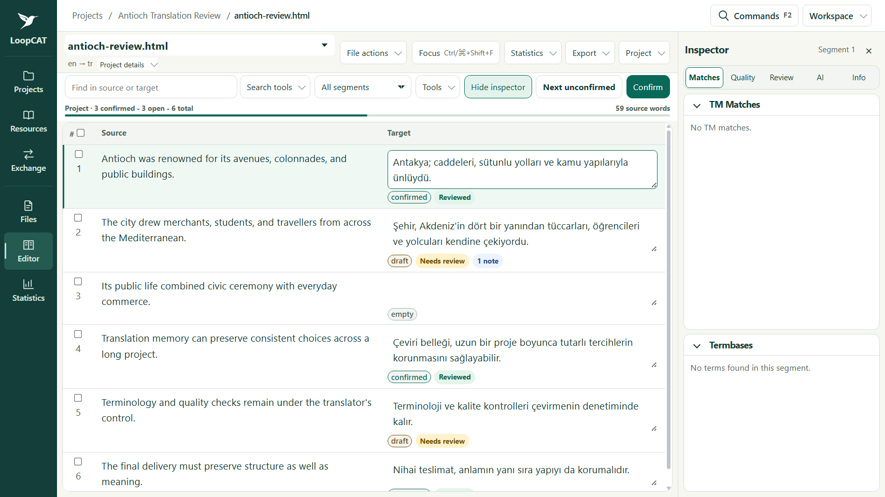

# LoopCAT workspace redesign verification

**21 November 2026 · Windows · Production web and desktop renderers**

The project rail, file breadcrumbs and contextual inspector now operate on the active project session. The editor gives the two languages equal reading columns and places review, QA and confirmation status beneath each target. Desktop users can resize or close the inspector. At smaller widths, its five tabs open in a sheet, and phone layouts label and stack the source and target. The same semantic light and dark colors apply to collections, editors, Exchange, statistics and recovery dialogs.

## Follow-up inspection of AI, Quality and Resources

The AI and Quality tabs still inherited spacing from the earlier sidebar. With a 320 px inspector at a 1536 × 810 viewport, the AI section header now measures 37 px, previously 52 px. Its first translation action moved from 377 px to 214 px below the top of the inspector. Quality now presents **Run QA checks** and file-specific findings above its profile and decision controls. A two-file check confirmed that moving to a clean file clears the previous file’s findings, and that following a finding on a narrow screen focuses the corresponding translation field.

The TM and termbase libraries now put resource type and search before display filters. Their independent editors use the same bilingual selection and save patterns. The visual checks include populated, empty and filtered resources, narrow layouts, and Arabic with mixed-direction entry text. [Compare the four revised screens](../../output/inspector-resources-review/index.html) · [Updated web build receipt](../../output/inspector-resources-review/web/build-receipt.json) · [Native resource-window checks](../../output/inspector-resources-review/resource-native-review.json)

## Reading space

These measurements use the same six-segment English–Turkish fixture at 1366 × 768, balanced density, with equal viewport denominators. The reference used a frozen copy of the renderer taken before the redesign.

| Measurement | Previous | Revised |
| --- | ---: | ---: |
| Source and target together, inspector open | 846.0 px (61.93%) | 882.4 px (64.60%) |
| Source and target together, inspector closed | 1,166.0 px (85.36%) | 1,212.8 px (88.78%) |
| Global header height | 66.3 px | 48.8 px |
| Scrollable segment area height | 561.9 px | 570.9 px |

The new rail is 87.6 px wide at this size. Both editor width gates passed. The separate toolbar test measured 141.1 px above the grid against a 150 px limit. There is a vertical tradeoff on narrower screens. At 1024 × 768 the scrollable segment area measured 501.9 px, previously 561.9 px. At 768 × 768 it measured 609.2 px, previously 652.4 px. A target with several review annotations can also take an extra line. The earlier Filters menu extended beyond the editor’s right edge at 1366 px. Both Search and Filters now fit and pass keyboard checks at 1366 px and 768 px. [Reference captures and measurements](../../test-artifacts/design-before/baseline.json) · [Revised captures and measurements](../../test-artifacts/design-after/baseline.json)

## Functional checks

| Area | Exercise and result |
| --- | --- |
| Projects and Files | Created a project, imported two text files, opened a specific file, switched workspaces and resumed that file. Checked the command palette, Statistics, Trash, keyboard focus return and a 320 px Arabic navigation drawer. |
| Bilingual editor | Toolbar, Matches, AI sidebar and consent suites passed. Exercised tag insertion, undo, selection, compact density, Focus mode, keyboard confirmation and narrow inspector dismissal. [Desktop reading layout](../../output/toolbar-verification/reading-open.png) · [Stacked phone layout](../../output/toolbar-verification/stacked-mobile.png) |
| Resources | Exercised library search, paging, draft editing, bulk operations, and reopen in native windows and Firefox/WebKit. Checked a narrow Arabic termbase, return to the same query, and visible focus. [Resource workspace](../../test-artifacts/resources-workspace/library.png) |
| Exchange | Exercised installed packs, authoring, previews, project activation, removal and the offline frozen lesson. The lab retains the chosen candidate and its keyboard focus across asynchronous updates. [Exchange captures](../../test-artifacts/exchange-ui) |
| Reports and transfers | Statistics, separate report window, locale and theme changes, file formats, multilingual Excel, export validation and recovery workflows passed their targeted checks. [Statistics captures](../../output/statistics-verification) |
| Accessibility and language | The 36 general axe scans passed with zero reported findings. The Arabic gate produced 97 captures, passed 11 functional checks and reported zero axe, clipping and localization findings. It includes 200% zoom and both themes. Edge forced-colors and reduced-motion checks verified visible keyboard focus and a 390 px stacked editor with no horizontal page overflow. Validated the English, Turkish, Spanish, Catalan and Arabic catalogs. [Arabic report](../../test-artifacts/arabic/report.json) · [Media preference checks](../../output/workspace-design/verification/media-preferences.json) |
| Offline upgrade | Used the previous renderer to edit a project, applied the update through the UI, then disabled network access and reloaded. Reopened all six segments, the saved edit, TM and term entry, and opened an independent TM editor offline. All three new stylesheets matched their expected hashes. [Upgrade report](../../output/workspace-design/verification/offline-upgrade.json) |
| Code quality | 1,744 unit tests passed. Lint, format, type checking, stylesheet checks and import boundaries passed. |
| Browser integration | All nine official suites passed, including the large project with 2,400 segments and 900 TM entries. An earlier concurrent run timed out on that case. It subsequently passed both alone and as the last case of a full run with the original limits. [Final nine-suite result](../../output/workspace-design/verification/browser-suites.log) |

## Keyboard and accessibility tree

Windows Edge also exposed both named navigation landmarks, the active Editor destination, current file, bilingual table headings and six individually named target fields in its accessibility tree. At 390 × 844, both navigation and inspector dialogs retained keyboard focus, Escape returned to the opener and the arrow keys changed inspector tabs. [Accessibility-tree evidence](../../output/workspace-design/verification/accessibility-tree.json)

## Local builds

The tested Windows x64 unpacked app and web ZIP share build ID `0.0.4-dev.20261115.1+source.020881daf8a9`. The web artifact contains 101 assets. The packaged Windows smoke test passed with hardware acceleration enabled and disabled, and its separate native resource-window test passed all 19 checks. [Windows application](../../dist/win-unpacked/LoopCAT.exe) · [Web package receipt and hashes](../../output/workspace-design/web/build-receipt.json) · [Packaged resource-window report](../../test-artifacts/resources-native/report.json)

## Release scope

The Exchange benchmark completed all 1,200 edits at 10,000 and 100,000 segments. All six paired comparisons passed. At 10,000 segments the slowest trial’s 95th percentile was 32.9 ms for the two-frame paint measure and 573.4 ms for a committed save. At 100,000 segments the largest paired ratios against the empty-library control were 1.020 for paint and 1.000 for save, within the 1.10 limit. All ten mixed-pack QA scans found the two expected issues and released the worker. [Full benchmark with per-edit timings](../../output/workspace-design/verification/exchange-performance.json)

The dedicated 100,000-entry resource test returned a first page in **5,986 ms** against the 2,000 ms goal. Warm paging took 1 ms, search took 199 ms and the largest main-thread timer gap was 26 ms. The November reference for the cold query was 3,375 ms. The cold query remains a release performance issue. It reads the selected resource from IndexedDB before applying the locale-aware ordering used by the editor. [Resource performance report](../../output/workspace-design/verification/resource-performance.json)

The product owner waived the user pilot. No participant task times or qualitative usability results were collected. NVDA and VoiceOver sessions and native macOS and Linux package smoke runs remain to be checked on their respective hosts. The downloadable artifacts in this workspace are local development builds.
